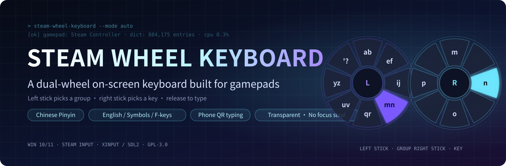
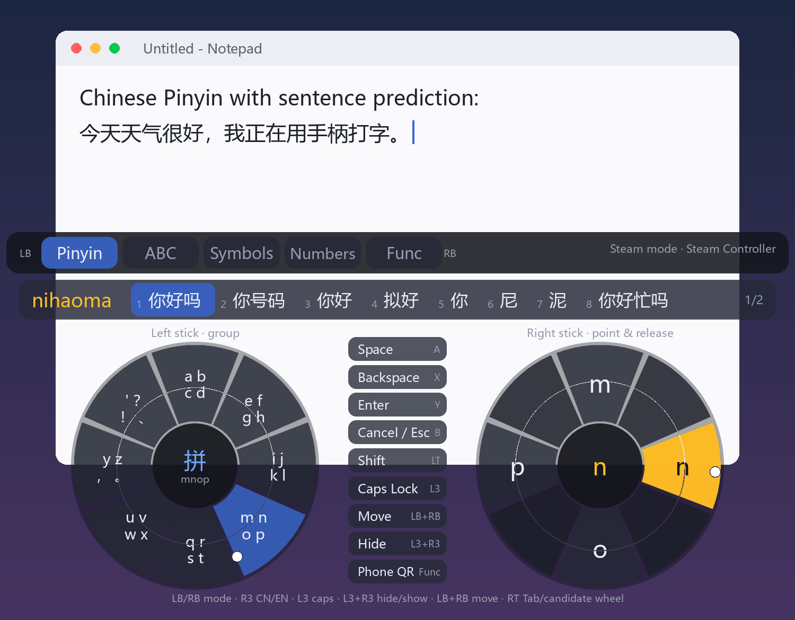
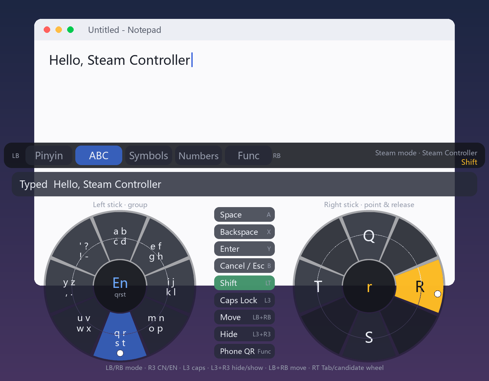
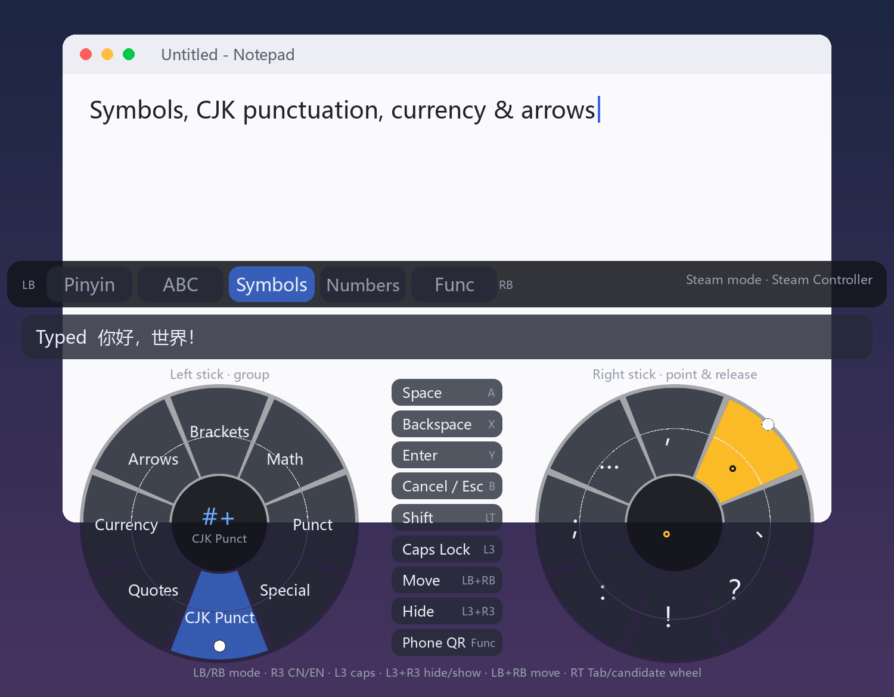
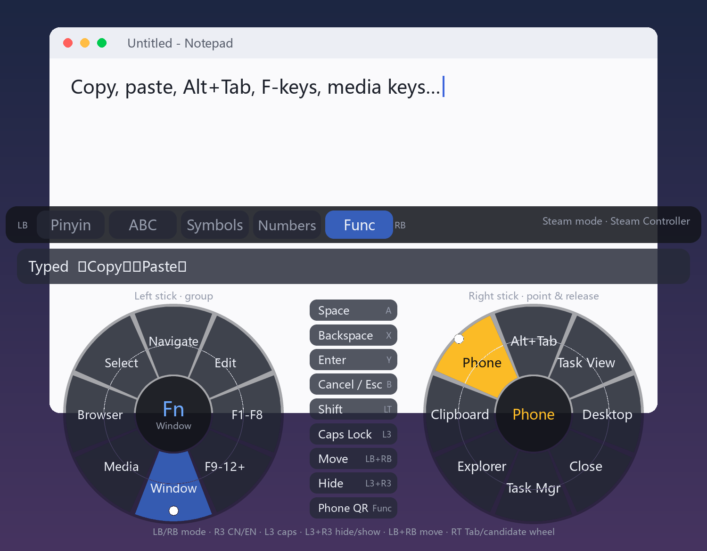
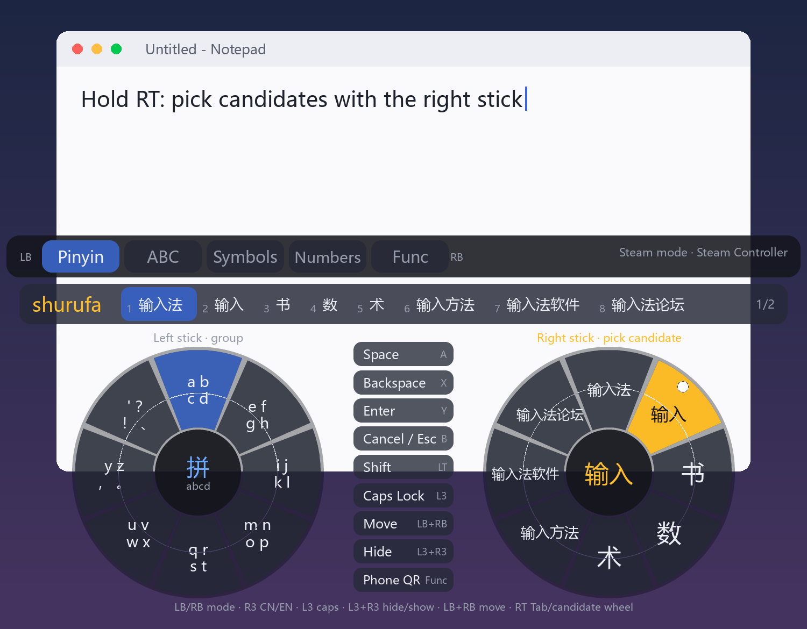
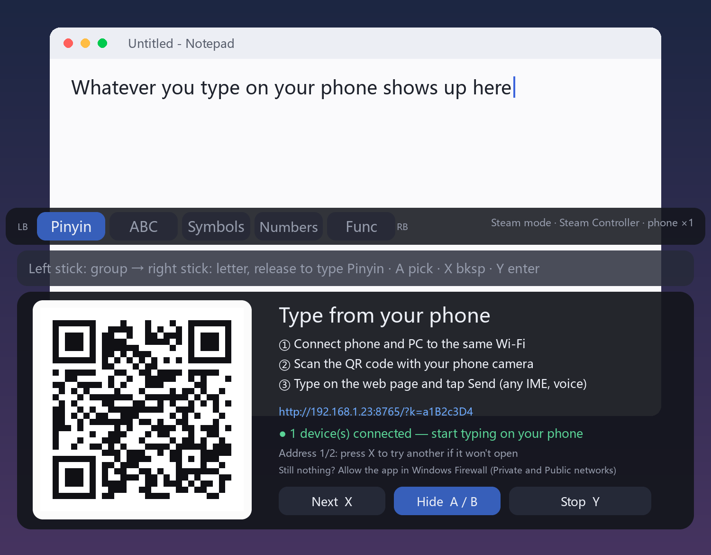
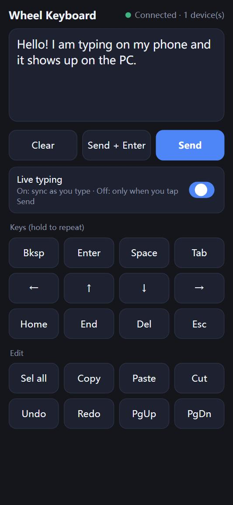
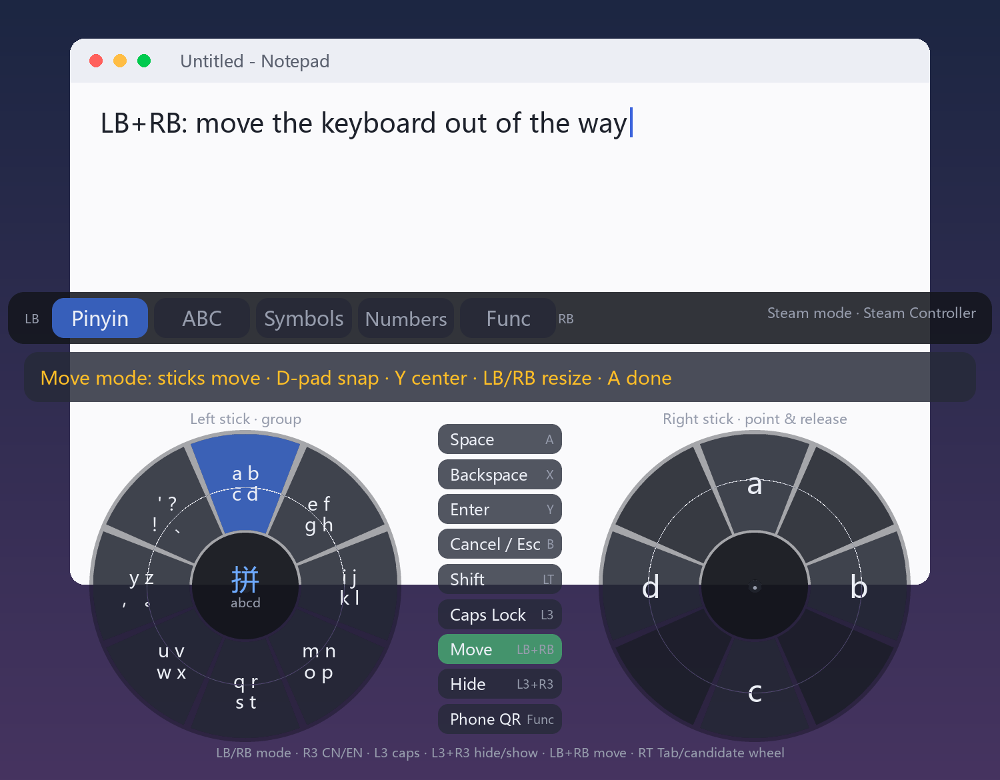

<div align="center">

<a href="README.md"></a>&nbsp;<a href="README.en.md"></a>



    

</div>


**A dual-wheel on-screen keyboard for the Steam Controller (and standard Xbox-style gamepads).** Left stick picks a group, right stick picks a character, release to type. Supports **Chinese Pinyin**, English, symbols, numbers and function keys/shortcuts. The window is **transparent, always-on-top and never steals focus**, and you can **scan a QR code to type on the PC from your phone**.




> Built for people who drive their PC with a controller (couch / big screen) where a physical keyboard isn't handy, and Steam's own on-screen keyboard has no Pinyin.
> The UI text is in Chinese; the layout and controls are universal.

---

## Features

- 🎡 **Dual-wheel input** – left stick (or left trackpad) selects one of 8 groups; right stick (or right trackpad) selects one of 8 characters in that group; **return the stick to center to type**. No confirm button.
- 🇨🇳 **Chinese Pinyin** – ~880k-entry dictionary ([rime-ice](https://github.com/iDvel/rime-ice)); whole-sentence input, initial-letter abbreviations, partial commit, `'` syllable separator, learns your choices, and a **candidate wheel** (hold RT, point with the right stick).
- 🔤 **5 modes** – Pinyin / ABC / Symbols / Numbers / Function (Esc, F1–F12, copy/paste, Alt+Tab, media keys, browser-tab shortcuts…). Switch with `LB/RB`.
- 📱 **Phone remote typing** – scan a QR code, open a tiny web page served on your LAN, and type with your phone's own keyboard (any language, voice input). Text lands at the PC's current cursor. Includes arrow/backspace/copy/paste buttons.
- 🪟 **Window** – true per-pixel transparency; topmost and **non-activating** (clicking it never takes focus from the app you're typing into); move/resize it **with the gamepad**; hide/show with `L3+R3`.
- 🛡️ **Anti-misfire** – deep-push threshold, dwell time, "must return to rest" after each character, single-frame glitch filter. All tunable.
- 🪶 **Light** – ~60 MB RAM, ~0.3 % of one core when idle, auto-lowered process priority so it never competes with your game.
- 🖱️ Works with a mouse/trackpad too (hover to select a group, click to type).

## Screenshots

| English + Shift | Symbols |
|---|---|
|  |  |

| Function keys | Candidate wheel (hold RT) |
|---|---|
|  |  |

| Phone QR | Phone web page | Move mode (LB+RB) |
|---|---|---|
|  |  |  |

> Screenshots are offline renders over a mock desktop.

## How it works (30 seconds)

1. **Left stick** → pick a group (e.g. `m n o p`). It stays selected when you let go.
2. **Right stick** → point at a character (e.g. `n`, it turns yellow) → **let go** → it's typed.
3. `A` space · `X` backspace · `Y` enter · `B` cancel/Esc · `LB/RB` switch mode · `R3` Chinese⇄English.

The dot on each wheel is the live stick position; the thin circle is the trigger line.

---

## Install & run: 2 ways × 2 modes

### Way 1 – prebuilt exe
Download `SteamWheelKeyboard-vX.Y.Z-win64.zip` from [Releases](../../releases), unzip to a permanent folder, run `SteamWheelKeyboard.exe`.
If Windows says *"An Application Control policy has blocked this file"*, **Smart App Control** is blocking the unsigned exe (this project has no code-signing certificate). Use Way 2 instead (Python itself is signed).

### Way 2 – from source
```powershell
git clone https://github.com/Allenhua/steam-wheel-keyboard.git
cd steam-wheel-keyboard
pip install -r requirements.txt
python build_dict.py --download     # downloads ~28 MB of rime-ice data and builds the dictionary (one-time)
python main.py                      # or run.bat / run-steam.bat / run-direct.bat
```
Without the dictionary everything works except Pinyin.

### Mode 1 – Steam mode (Steam is running)
For Steam Controller / Steam Deck while Steam is open. Steam normally puts the controller in its *Desktop layout* (trackpad = mouse, buttons = keyboard) and does **not** expose it as a gamepad, so the app can't read the sticks. Make Steam treat the app as a "game":

1. Steam → **Add a Game → Add a Non-Steam Game** → add either `SteamWheelKeyboard.exe`, **or** your `pythonw.exe` and then *Properties → Shortcut*: Start In = `"<project dir>"`, Launch Options = `"<project dir>\main.py" --steam`.
2. Select it in your library → controller icon → choose the **Gamepad** template.
3. **Launch it from Steam** (not by double-clicking).
4. The top-right of the keyboard shows the controller name (or `XInput 手柄 ×1`); pressing any button briefly shows its name. "无手柄" (no gamepad) means Steam isn't handing the pad over — recheck the layout.

*Zero-config fallback:* with the stock Desktop layout you can still use the **trackpad as a mouse** (hover to select, click to type); only the gamepad buttons won't work.

### Mode 2 – non-Steam (direct)
For Xbox / PlayStation / Switch Pro / generic XInput pads or Steam Deck **without Steam running**. The app reads the pad through SDL2 (HIDAPI) + XInput. Run `run-direct.bat` or `python main.py --direct`. `mode: auto` picks Steam mode if `steam.exe` is running, otherwise direct.

Notes: the new **Steam Controller (2026)** is only a plain mouse+keyboard device without Steam and the bundled SDL2 can't read its sticks (tested) — use Steam mode. Xbox/PS support follows the standard XInput/SDL interfaces but the author has no physical pads to verify; feedback welcome.

Switching: `config.json` → `"mode"`, CLI `--steam` / `--direct`, or **hold Start/Menu for 1.5 s** on the gamepad (restarts the app).

---

### Steam Big Picture mode

While Big Picture is in the foreground, Steam routes the controller **only to the foreground app** (Big Picture itself), so the keyboard receives nothing. With `focus_mode: auto` (default) the keyboard takes focus while it is shown over Big Picture, delivers each committed text back to Big Picture, and gives focus back when hidden (`L3+R3`).

Once hidden, the controller belongs to Big Picture again and the keyboard can't hear `L3+R3`. To **show it again**, make a global Steam chord send `Ctrl+Alt+K`. The neatest option is to repurpose **Steam + X** (by default it opens Steam's own keyboard):

1. Settings → **Controller** → **Show advanced settings** → **Non-game controller layouts → Guide Button Chord Layout** → **Edit** → **Edit layout**;
2. **Buttons → Face buttons → X**: click the current "Show keyboard" binding → **Keyboard** tab → **Ctrl**;
3. ⚙ next to it → **Add sub command** → **Alt**; ⚙ → **Edit multi-binding timing** → **+** on the Ctrl/Alt group → **K**;
4. Change the activation from **Release press** to **Regular press** (release press only emits a ~30 ms pulse that can be missed);
5. Back out to save. **Hold Steam + X** now shows/hides the wheel keyboard everywhere.

To keep Steam's keyboard, bind a free button instead (e.g. back button **R5**). Or set `"hotkey_toggle"` to a single key (e.g. `"f12"`) and bind just that. `focus_mode` can also be `always` or `never`.

> [!NOTE]
> In Big Picture, activating a text field with A **auto-opens Steam's own keyboard**; Steam has **no setting to turn that off**. Press **B** to dismiss it, then **Steam + X** for the wheel keyboard — text goes into that field.

## Controls

| Input | Action |
|---|---|
| Left stick | Select group (8 directions, sticky) |
| Right stick | Point at a character; **release to type** |
| `A` | Space; with Pinyin candidates = commit highlighted candidate |
| `B` | Cancel Pinyin; otherwise Esc |
| `X` | Backspace (hold to repeat) |
| `Y` | Enter; with Pinyin = commit raw letters |
| `LB` / `RB` | Previous / next mode |
| `R3` | Chinese ⇄ English |
| `L3` | Caps lock (ABC mode) |
| `LT` (hold) | Shift |
| `RT` | Tab; **with Pinyin: hold = candidate wheel** |
| D-pad | Arrow keys; with Pinyin: left/right select, **up/down page** |
| `L3 + R3` | Hide / show keyboard |
| `LB + RB` | Move/resize mode (stick = move, D-pad = snap to edge, `Y` = center, `LB/RB` = smaller/bigger, `A`/`B` = done) |
| Hold `Start` 1.5 s | Toggle Steam ⇄ direct mode |
| `Ctrl+Alt+K` / `Ctrl+Alt+P` | Hide-show / phone QR panel (PC keyboard) |

`L3/R3/LB/RB` act on **release** so they don't clash with the chords.

## Pinyin
Whole sentence (`woxiangquchifan`), abbreviations (`nh`), partial commit (`nihaoma` → pick 你好, keep typing `ma`), `xi'an` → 西安, common single characters first for single syllables (`xian` → 先 现 …), learns your picks (`data/user.json`). Paging: D-pad up/down. Dictionary: [rime-ice](https://github.com/iDvel/rime-ice) (8105 chars + 540k base words + 340k extended words), **not committed** — built locally by `python build_dict.py --download` into a SQLite file queried on demand.

## Phone remote typing
Open it via the **手机扫码** button, `Ctrl+Alt+P`, or on the gamepad: *Function* page → left stick down ("窗口" group) → right stick up-left ("手机输入"). Phone and PC must be on the **same Wi-Fi**. Scan, open the page, type, tap **发送** (send) — or enable **实时输入** (live sync; IME composition is only sent when committed). On the QR panel: `X` next address, `A/B` hide QR (phone keeps working), `Y` stop.

Security: a fresh random token is generated each time and embedded in the QR URL; requests without it are rejected; LAN only; the port is bound exclusively; stopping closes the server. **Don't share the QR code** — anyone on your LAN who has it can type on your PC.
If it can't connect: press `X` to try another address (multi-NIC PCs), allow the app in Windows Firewall (tick both Private and Public), and avoid routers with AP isolation.

## Config
`config.json` is created on first run (see [`config.example.json`](config.example.json)): `mode`, `lang` (auto/zh/en), `focus_mode` (auto/always/never), `hotkey_toggle`, `hotkey_phone`, `scale`, `position`, `x`/`y`, `opacity`, `bg_alpha`, `panel_alpha`, `ascii_via_vk`, `start_hidden`, `toggle_hotkey`, `debug`, and `wheel.{enter, exit, dwell, cooldown, rest, group}` for anti-misfire tuning (raise `enter`/`dwell` if you get stray characters). Details in the Chinese README.

## Performance
~58 MB RAM and ≈0.3 % of one core when idle (≈5 % of one core while redrawing continuously); hidden ≈0.3 %. Priority is lowered to *Below Normal*. For **fullscreen games**, hide the keyboard (`L3+R3`) when not typing — a visible topmost window can disable Windows' fullscreen optimizations for some games. Borderless-window mode is unaffected.

## Limitations
Windows only · tested on a new Steam Controller (2026) in Steam mode only · Pinyin uses a unigram model (no context LM) · no Wubi/Shuangpin/cloud suggestions yet · phone input needs the same LAN.

## Development
```powershell
pip install -r requirements-dev.txt
python build_dict.py --download
python tests/test_keyboard.py
python tests/test_phone.py
python tools/make_screenshots.py
powershell -ExecutionPolicy Bypass -File build_exe.ps1
```

## License & credits
**[GPL-3.0](LICENSE)** — because the Pinyin dictionary data comes from the GPL-3.0 project [rime-ice](https://github.com/iDvel/rime-ice). Thanks to rime-ice, [pygame-ce / SDL2](https://github.com/pygame-community/pygame-ce) and [segno](https://github.com/heuer/segno). See [NOTICE.md](NOTICE.md).
