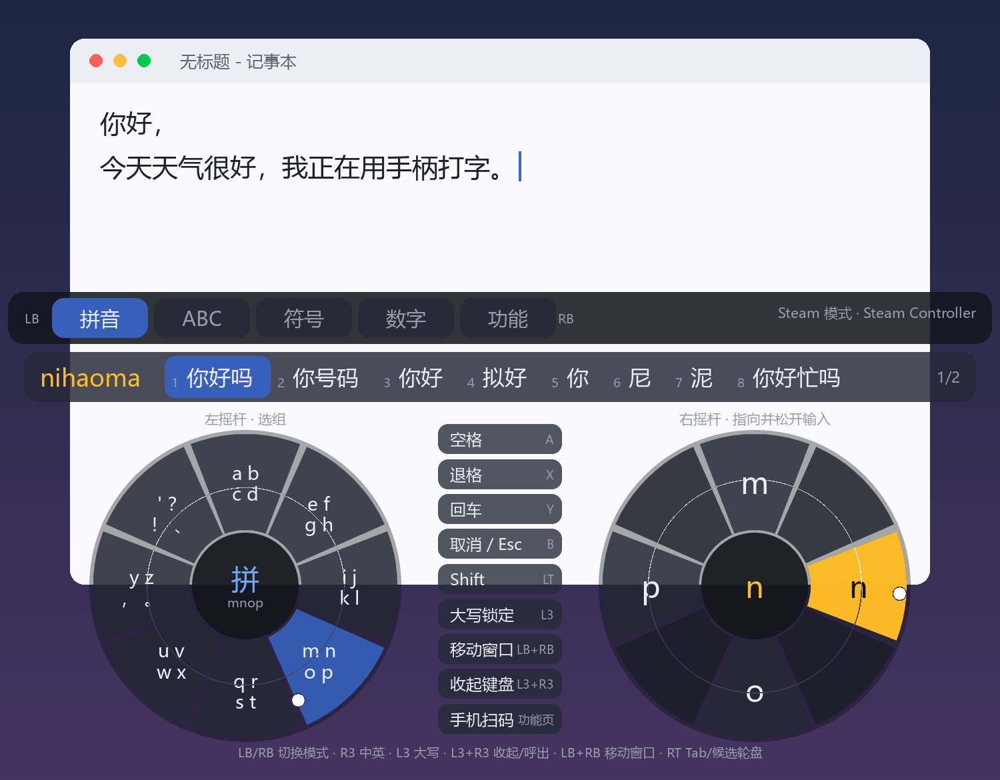
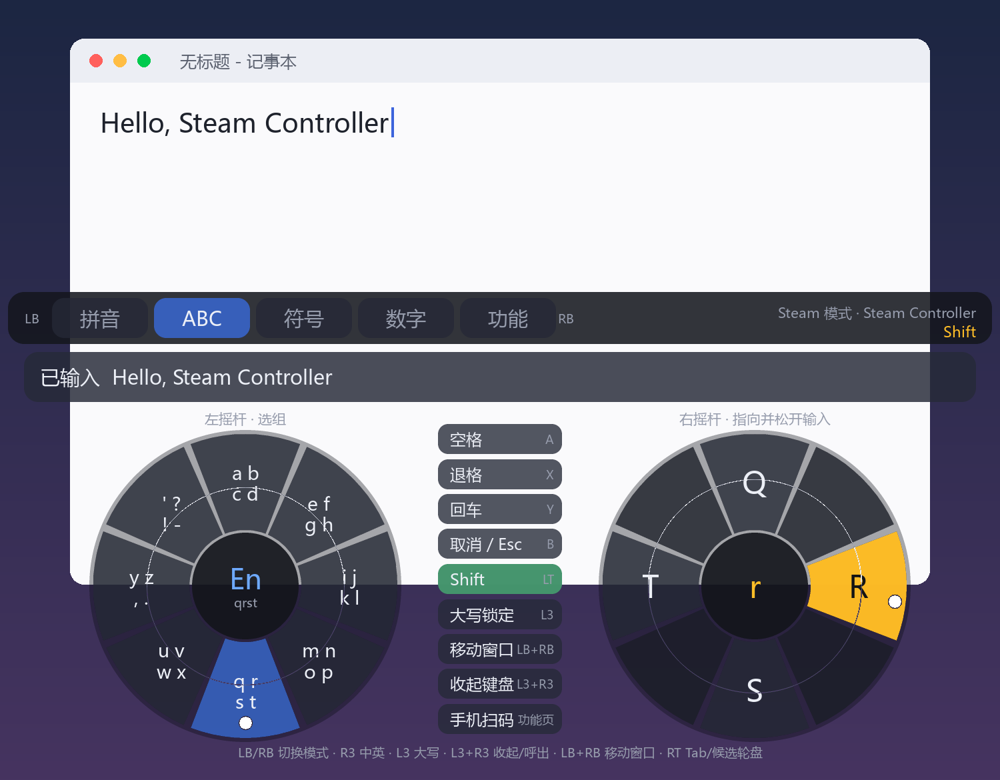
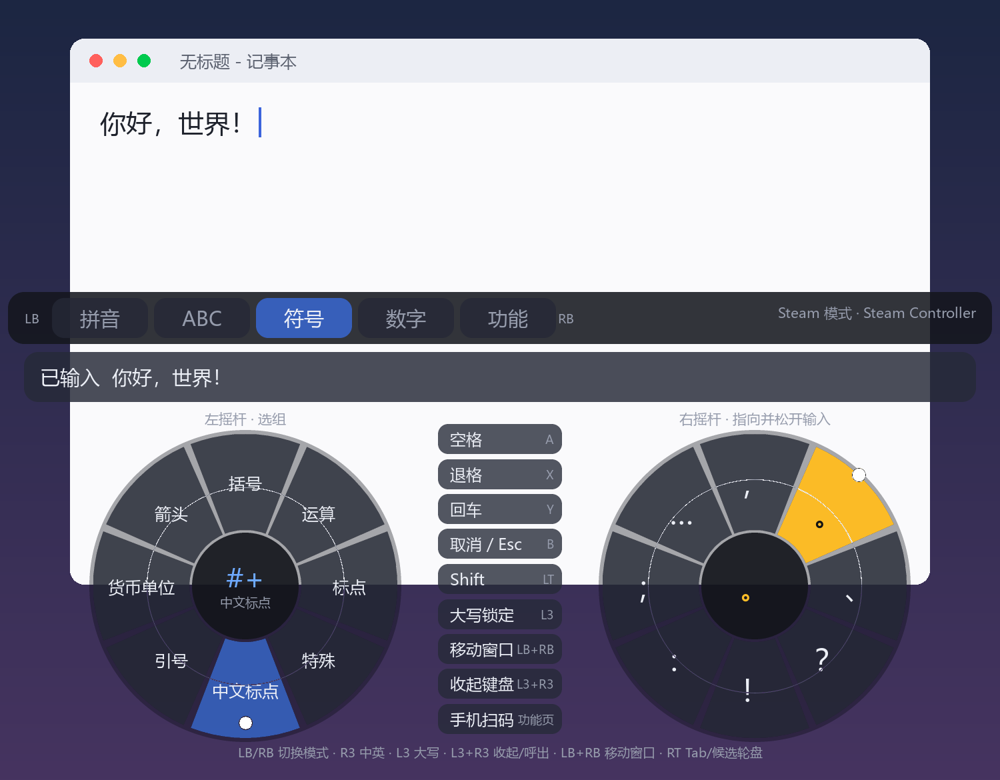
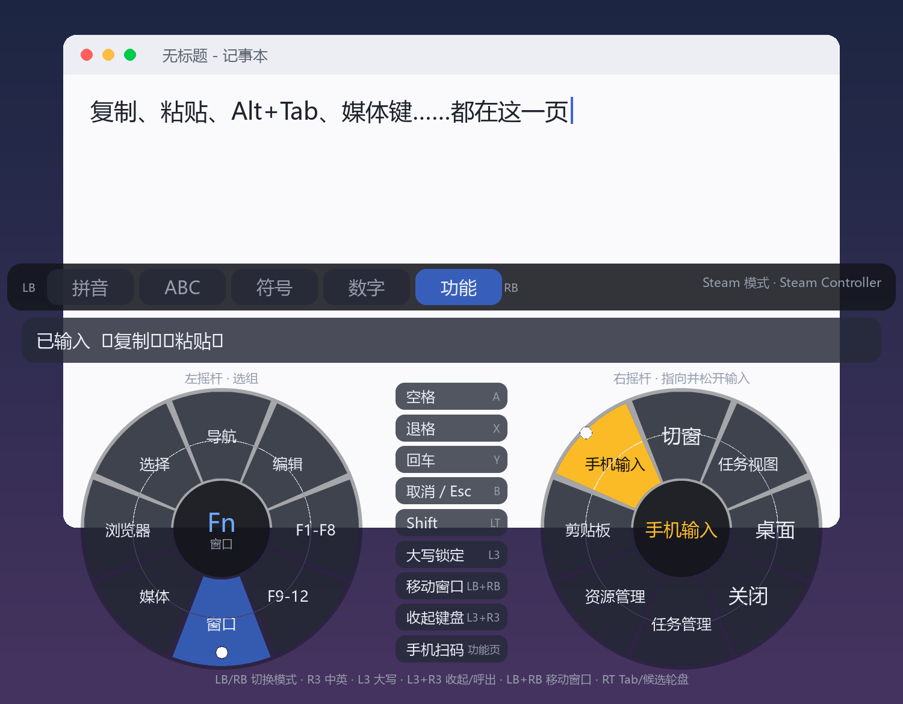
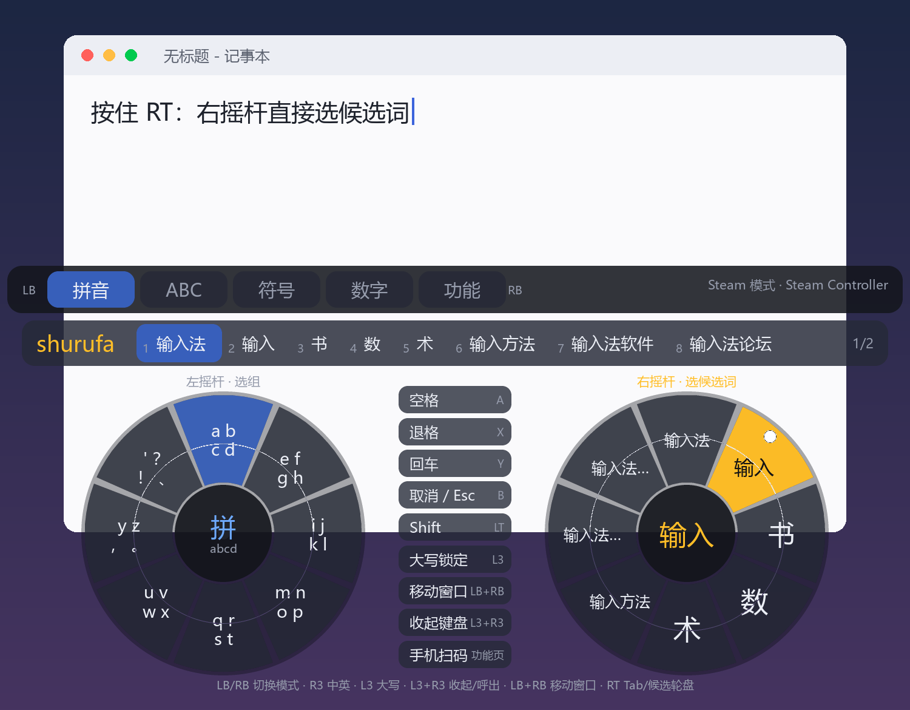
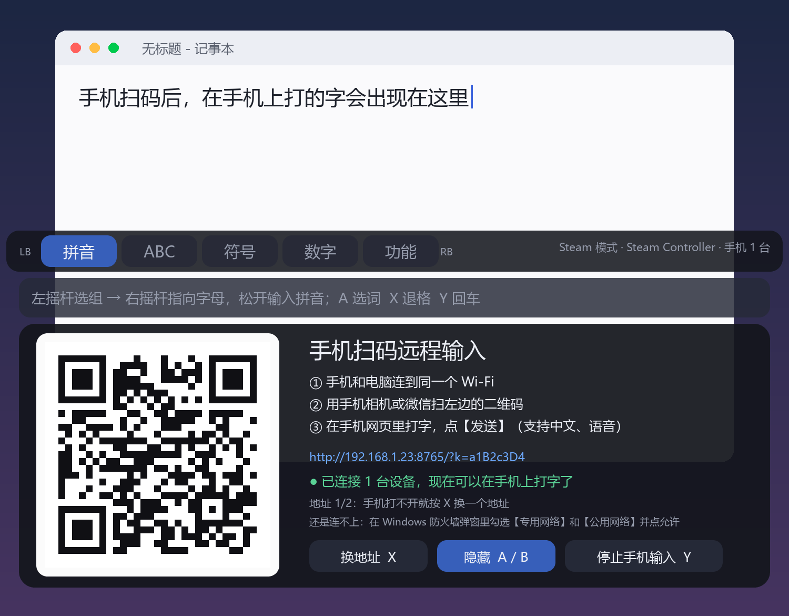
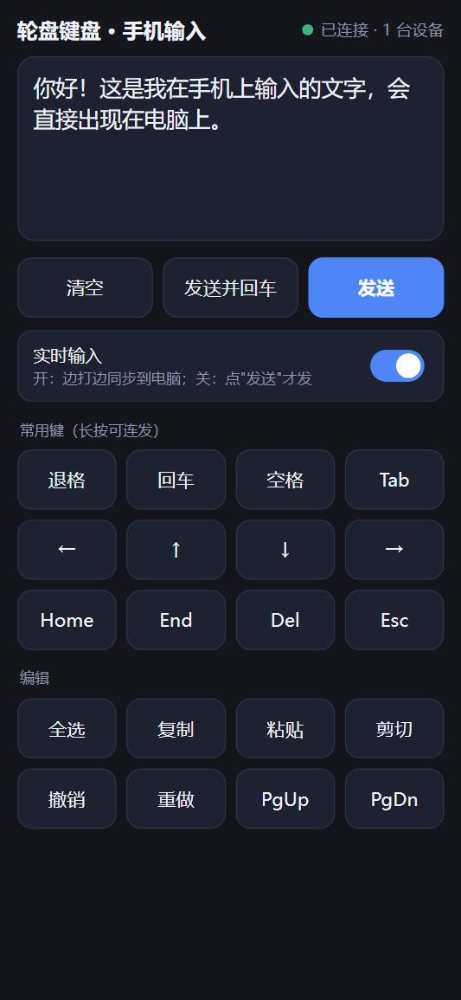
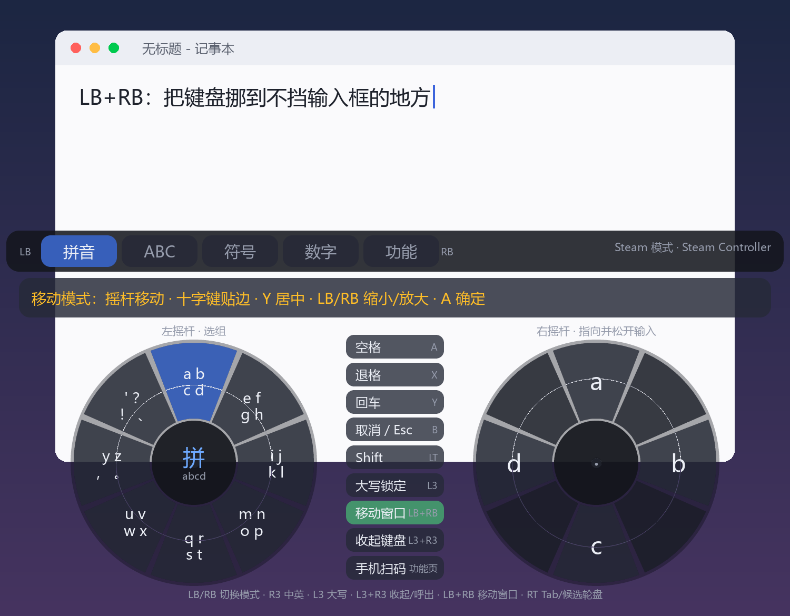

# 轮盘键盘 · Steam Wheel Keyboard

**给 Steam Controller（以及 Xbox 等标准手柄）用的双轮盘屏幕键盘。** 左摇杆选组、右摇杆选字、松开就输入——支持**中文拼音**、英文、符号、数字、功能键/快捷键，窗口**透明置顶、不抢焦点**，还能**手机扫码，用手机输入法给电脑打字**。

[English](README.en.md) · Windows 10/11 · Python 3.10+ · [GPL-3.0](LICENSE)



> 用手柄控制电脑（客厅 / 沙发 / 大屏）时，没法敲键盘，Steam 自带的屏幕键盘又不好用、不能打拼音。这个项目就是为此做的。

---

## 目录
- [功能一览](#功能一览)
- [截图](#截图)
- [怎么用：先学会这个](#怎么用先学会这个)
- [安装与运行：两种方式 × 两种模式](#安装与运行两种方式--两种模式)
- [按键一览](#按键一览)
- [拼音输入](#拼音输入)
- [手机扫码远程输入](#手机扫码远程输入)
- [窗口：透明 / 移动 / 缩放](#窗口透明--移动--缩放)
- [配置](#配置)
- [性能](#性能)
- [常见问题](#常见问题)
- [已知限制](#已知限制)
- [开发](#开发)
- [许可证与致谢](#许可证与致谢)

---

## 功能一览

- 🎡 **双轮盘输入**：左摇杆（或左触摸板）在 8 个"组"里选一组，右摇杆（或右触摸板）在组内 8 个字符里选一个，**回中松开即输入**，不用按任何确认键。
- 🇨🇳 **中文拼音**：88 万条词库（[rime-ice 雾凇拼音](https://github.com/iDvel/rime-ice)），支持**整句输入**（`jintiantianqihenhao` → 今天天气很好）、**首字母缩写**（`nh` → 女孩/你好…）、**部分上屏**、`'` 分音节（`xi'an` → 西安），会**学习你的选词习惯**；有"**候选轮盘**"——按住 RT，右摇杆直接指向候选词。
- 🔤 **5 种模式**：拼音 / ABC / 符号（含中文标点、引号、货币、箭头）/ 数字（含中文数字、圈数字）/ 功能（Esc、F1–F12、复制粘贴、Alt+Tab、媒体键、浏览器标签页快捷键…），`LB/RB` 切换。
- 📱 **手机扫码远程输入**：手机和电脑同一个 Wi-Fi，扫码打开网页，用手机自带的输入法（中文、语音）打字，文字直接输入到电脑当前光标处，还带方向键、退格、复制粘贴等按键。
- 🪟 **窗口体验**：真·逐像素**透明**背景；**置顶且不抢焦点**（点它不会让你正在输入的窗口失去光标）；**手柄就能移动 / 缩放窗口**，位置自动记住；不用时 `L3+R3` 一键收起。
- 🛡️ **防误触**：推到 70% 才算选中、同一方向要停留一小会儿、输入后摇杆必须回中才能打下一个、单帧毛刺会被滤掉；所有阈值可在 `config.json` 里调。
- 🪶 **很轻**：内存约 60 MB，空闲 CPU ≈ 0.3% 单核，进程优先级自动降到"低于正常"，不跟游戏抢资源。
- 🖱️ **鼠标 / 触摸板也能用**：悬停选组、点击选字，Steam 默认的"桌面布局"（触摸板当鼠标）下零配置可用。

## 截图

| 英文 + Shift | 符号 |
|---|---|
|  |  |

| 功能键 / 快捷键 | 候选轮盘（按住 RT） |
|---|---|
|  |  |

| 手机扫码 | 手机上的网页 | 移动窗口（LB+RB） |
|---|---|---|
|  |  |  |

> 截图是离线渲染的示意图（叠在模拟桌面上），界面与实际一致。

## 怎么用：先学会这个

1. **左摇杆**推向某个方向 → 左轮选中一"组"（比如 `m n o p`）。选中的组会**保持**，松开左摇杆也不会变。
2. **右摇杆**推向右轮上的某个字符（比如 `n`）→ 该字符变黄 → **松手回中** → 字符输入。
3. `A` 空格 · `X` 退格 · `Y` 回车 · `B` 取消/Esc · `LB/RB` 切换模式 · `R3` 中英切换。

轮盘上的**圆点**是摇杆当前位置，**细线圈**是触发线：圆点越过细线（变白）才算"指向"。

---

## 安装与运行：两种方式 × 两种模式

先选**怎么启动程序**（方式），再选**怎么拿到手柄输入**（模式）。

### 方式一：下载打包好的 exe（推荐新手）

1. 到 [Releases](../../releases) 下载 `SteamWheelKeyboard-vX.Y.Z-win64.zip`，解压到一个**固定的文件夹**（别放在临时目录）。
2. 双击 `SteamWheelKeyboard.exe`。
3. ⚠️ 如果提示"**应用程序控制策略已阻止此文件**"：这是 Windows 的"智能应用控制"在拦截**没有数字签名**的新程序。本项目没有购买代码签名证书，所以请改用**方式二**（Python 本身有签名，运行脚本不会被拦）。*不建议为此关闭智能应用控制，那是整机防护，且在不少版本里关了就不能再打开。*

### 方式二：从源码运行

```powershell
# 1. 装 Python 3.10+（https://www.python.org/ ，安装时勾选 Add to PATH）
git clone https://github.com/Allenhua/steam-wheel-keyboard.git
cd steam-wheel-keyboard

# 2. 装依赖（pygame-ce + 二维码库 segno）
pip install -r requirements.txt

# 3. 下载并生成拼音词库（约 28 MB 下载，生成 ≈ 85 MB，只需一次）
python build_dict.py --download

# 4. 运行
python main.py            # 自动选模式
# 或双击 run.bat（无控制台窗口）、run-steam.bat、run-direct.bat
```

> 没有词库也能运行，只是拼音模式不可用（会提示先运行第 3 步）。

### 模式一：Steam 模式（Steam 在运行，手柄由 Steam Input 接管）

**适用**：你用 Steam Controller / Steam Deck，并且 Steam 开着（这是最常见的情况）。

**原理**：Steam 开着时，Steam Controller 默认处于"**桌面布局**"——触摸板被模拟成鼠标、按键被模拟成键盘，Steam **不会**把它当成"手柄"交给任何程序，所以本程序读不到摇杆。要让它读到，需要让 Steam 把本程序当作一个"游戏"，给它一个**手柄布局**。

**设置（一次性）**：

1. Steam 左下角 **添加游戏 → 添加非 Steam 游戏**，然后加入下面**二选一**：
   - **用 exe**：浏览选 `SteamWheelKeyboard.exe`；
   - **用 Python 脚本**：浏览选你的 `pythonw.exe`（例如 `C:\Users\<你>\AppData\Local\Programs\Python\Python312\pythonw.exe`），然后在库里右键 → **属性 → 快捷方式**，填：
     - 起始位置：`"<项目目录>"`
     - 启动选项：`"<项目目录>\main.py" --steam`
2. 在库里选中它 → 右侧"控制器"图标 → 布局选 **Gamepad（手柄）** 模板。
3. **从 Steam 里点"开始"启动它**（不要双击启动，否则 Steam 不会给它分配手柄布局）。
4. 看键盘窗口**右上角**：应显示手柄名称（如 `Steam Controller`）或 `XInput 手柄 ×1`，随便按个键会短暂显示"按下 X"——说明通了。显示"无手柄"、按键没反应，就是 Steam 没把手柄交给它，回到第 2 步检查布局。

**零配置的备选**：不做上面的设置，直接在 Steam 桌面布局下用**触摸板当鼠标**——悬停左轮选组、点击右轮选字，也能打字（但手柄按键不起作用）。

**注意**：这种方式下，键盘运行期间该控制器由"手柄布局"接管。想同时用触摸板当鼠标，请在该布局里把某块触摸板设成"鼠标"，摇杆保持摇杆。

### 模式二：非 Steam 模式（直连）

**适用**：没开 Steam，用 **Xbox / PlayStation / Switch Pro / 通用 XInput 手柄**，或者 Steam Deck。

**原理**：程序通过 SDL2 的 HIDAPI + XInput 直接读取手柄，不依赖 Steam。

**用法**：直接运行（`run-direct.bat`，或 `python main.py --direct`）。程序也会在 `mode: auto` 下自动判断：检测到 `steam.exe` 在运行就用 Steam 模式，否则用直连模式。

**注意**：
- 新款 **Steam Controller（2026）** 在没有 Steam 时只是一个普通的鼠标 + 键盘设备，本项目使用的 SDL2 目前**读不到它的摇杆**（作者实测），请用 Steam 模式。
- 直连模式的 Xbox / PS 手柄支持是**按 XInput / SDL 标准接口实现**的，作者没有这些手柄的实机，欢迎反馈。

### 切换模式

| 方法 | 说明 |
|---|---|
| `config.json` 的 `"mode"` | `auto`（默认）/ `steam` / `direct` |
| 命令行 | `--steam` 或 `--direct` |
| 手柄 | **长按 Start/Menu 1.5 秒**，在 Steam ⇄ 直连之间切换（会自动重启） |

---

## 按键一览

> 以 Xbox 手柄的叫法为准。Steam Controller 在 "Gamepad" 布局下的对应关系相同。

| 操作 | 说明 |
|---|---|
| 左摇杆 | 选组（8 个方向，选中后保持） |
| 右摇杆 | 指向字符，**回中松开时输入** |
| `A` | 空格；有拼音时 = 上屏当前高亮的候选 |
| `B` | 有拼音时取消；否则发送 Esc |
| `X` | 退格（可长按连发） |
| `Y` | 回车；有拼音时直接上屏拼音字母 |
| `LB` / `RB` | 上一个 / 下一个模式（拼音·ABC·符号·数字·功能） |
| `R3`（右摇杆按下） | 中文 ⇄ 英文 |
| `L3`（左摇杆按下） | 大写锁定（ABC 模式） |
| `LT`（按住） | Shift |
| `RT` | 无拼音时 = Tab；**有拼音时按住 = 候选轮盘**（右摇杆直接选候选词） |
| 十字键 | 无拼音时 = 方向键；有拼音时：左右选候选、**上下翻页** |
| **`L3 + R3`** 同时按 | 收起 / 呼出键盘 |
| **`LB + RB`** 同时按 | 移动窗口模式（见下） |
| 长按 `Start` 1.5 秒 | 切换 Steam / 直连模式 |
| `Ctrl+Alt+K`（电脑键盘） | 收起 / 呼出 |
| `Ctrl+Alt+P`（电脑键盘） | 手机扫码面板 |

> `L3`、`R3`、`LB`、`RB` 单独按时在**松开**时才生效（为了不和组合键冲突）。

---

## 拼音输入

在"拼音"模式用轮盘打出拼音字母，上方出现候选栏：

- **整句**：`woxiangquchifan` → 我想去吃饭
- **缩写**：`nh` → 女孩 / 你会 / 您好…
- **部分上屏**：`nihaoma` 先选"你好"，剩下的 `ma` 继续
- **分音节**：`xi'an` → 西安（`'` 在左轮"'？！"那一组）
- **单音节常用字优先**：`xian` → 先 现 显 …（再是 西安）
- **学习**：选过的词下次排最前，保存在 `data/user.json`
- **翻页**：十字键上下；左右逐个移动；`A` 上屏
- **候选轮盘**：按住 `RT`，右轮变成当前页的 8 个候选词，右摇杆直接指向并松开即上屏；十字键上下仍可翻页
- 打标点（，。？！、）时会先自动上屏当前首选候选

词库：[rime-ice 雾凇拼音](https://github.com/iDvel/rime-ice)（8105 常用字 + 54 万基础词 + 34 万扩展词，含词频与多音字）。词库**不随仓库提交**，运行 `python build_dict.py --download` 在本地生成（SQLite，按需查询，内存占用很小）。

## 手机扫码远程输入

让你用**手机自带的输入法**（中文、语音、联想都能用）给电脑打字，文字直接输入到电脑当前光标所在的位置。

**打开**：界面中间的"**手机扫码**"按钮 / 键盘 `Ctrl+Alt+P` / 手柄：切到"功能"页 → 左摇杆选"窗口" → 右摇杆选"手机输入"。

**使用**：
1. 手机和电脑连**同一个 Wi-Fi**；
2. 手机相机 / 微信扫界面上的二维码，打开网页（不用装 App）；
3. 在网页里打字，点 **发送**；或打开"**实时输入**"，边打边同步（中文输入法"组合"过程中不会提前发送，确认后一次性发送）；
4. 网页下面有退格、回车、方向键、Tab、Esc、全选/复制/粘贴/撤销等按键，方向键和退格可长按连发。

二维码面板上：`X` 换地址 · `A/B` 隐藏二维码（手机仍可继续用）· `Y` 停止手机输入。

**安全**：每次开启都会生成一次性随机口令写进二维码网址，没有口令的请求一律拒绝；只在局域网内可访问，停止后服务立即关闭；端口独占绑定。**请不要把二维码发给别人或公开截图**——同一局域网内拿到它的人就能往你电脑里打字。

**连不上怎么办**：
- 电脑有多个网卡时，面板里的地址可能不是你的 Wi-Fi → 按 `X` 换一个（程序会优先选"有默认网关"的网卡）；
- **Windows 防火墙**：第一次开启会弹窗，请勾选 **专用网络** 和 **公用网络** 后允许；Wi-Fi 被标成"公用网络"时尤其要注意；
- 路由器开了"AP 隔离 / 客人网络"时手机访问不到电脑，换成同一个普通 Wi-Fi。

## 窗口：透明 / 移动 / 缩放

- **透明**：真正的逐像素透明窗口，空白处能看到下面的内容，鼠标也能点穿。`config.json` 里调 `opacity`（整体）、`bg_alpha`（轮盘/按钮底色）、`panel_alpha`（整块底板，默认没有）。
- **移动（手柄）**：同时按 **`LB + RB`** → 摇杆移动窗口、十字键贴边、`Y` 水平居中、`LB/RB` 缩小/放大、`A`/`B` 确定。
- **移动（鼠标 / 触摸板）**：按住**顶栏**拖动；**滚轮**缩放。
- 位置和大小自动记住。默认大小按屏幕自动计算（宽 ≤ 屏幕 45%、高 ≤ 36%）。

## 配置

首次运行会在程序目录生成 `config.json`（参考 [`config.example.json`](config.example.json)）：

| 字段 | 默认 | 说明 |
|---|---|---|
| `mode` | `auto` | `auto` / `steam` / `direct` |
| `scale` | `0` | `0` = 按屏幕自动；或 `1.0` / `1.5` / `2.0`（也可用窗口缩放，自动记住） |
| `position` | `bottom` | 首次出现位置：`bottom` / `top` |
| `x`, `y` | `null` | 窗口位置（拖动/移动后自动记住） |
| `opacity` | `0.96` | 整体不透明度 |
| `bg_alpha` | `0.8` | 轮盘/按钮底色不透明度（越小越透明） |
| `panel_alpha` | `0.0` | 整块底板不透明度，`0` = 没有底板 |
| `ascii_via_vk` | `false` | `true`：英文字符用真实按键码发送（个别游戏只认按键时开） |
| `start_hidden` | `false` | 启动时先收起 |
| `toggle_hotkey` | `true` | 启用 `Ctrl+Alt+K` / `Ctrl+Alt+P` |
| `debug` | `false` | `true`：把手柄原始数据写入 `debug.log` |
| `wheel.*` | 见下 | 摇杆防误触参数 |

**摇杆太灵敏 / 老是误输入？** 调 `wheel`：

| 参数 | 默认 | 效果 |
|---|---|---|
| `enter` | 0.70 | 推多深才算"指向"。调大（0.8）= 更不容易误触 |
| `exit` | 0.40 | 回到多浅算"松开"并输入 |
| `dwell` | 0.07 | 同一方向要停留多久（秒）才有效。调大（0.12）= 防手滑 |
| `cooldown` | 0.15 | 两次输入之间的最短间隔（秒） |
| `rest` | 0.25 | 输入后摇杆要回到这个幅度以内才能打下一个 |
| `group` | 0.65 | 左摇杆推多深才切换"组" |

## 性能

实测（16 核机器，键盘显示着）：

| 状态 | CPU | 内存 |
|---|---|---|
| 显示着，手柄不动 | ≈ 0.3% 单核（整机 0.02%） | ≈ 58 MB |
| 鼠标在轮盘上疯狂划动（最坏重绘） | ≈ 5% 单核（整机 0.3%） | ≈ 56 MB |
| 隐藏 | ≈ 0.3% 单核 | ≈ 56 MB |
| 开着手机输入 | ≈ 0.3% 单核 | ≈ 65 MB |

进程优先级自动降为"低于正常"；词库放在磁盘 SQLite 里按需查询；空闲时降低轮询频率；纯 CPU 绘制，不占显卡。

**玩全屏游戏时**：键盘是置顶的透明窗口，显示着时 Windows 可能无法对全屏游戏启用"独立翻转 / 全屏优化"，极个别游戏会多一点点延迟。不打字时按 `L3+R3` **收起**即可（隐藏后不参与桌面合成）。游戏用"无边框窗口"模式则没有这个问题。

## 常见问题

**右上角显示"无手柄"，RB 切不了模式？** Steam 没把手柄交给本程序——见 [Steam 模式](#模式一steam-模式steam-在运行手柄由-steam-input-接管)，必须从 Steam 里启动它并选 Gamepad 布局。

**exe 双击提示"应用程序控制策略已阻止此文件"？** Windows 智能应用控制拦截了没有签名的新程序。改用[方式二](#方式二从源码运行)（`pythonw.exe` 有签名），或自己决定是否关闭智能应用控制。

**打字没反应 / 打不进游戏？** 文字默认以 Unicode 方式注入（输入框通用）。个别游戏只认按键码，把 `ascii_via_vk` 设为 `true`；用独占全屏的游戏可能收不到任何模拟输入，改"无边框窗口"。

**点击键盘会让输入框失去光标吗？** 不会，窗口是"不激活"的。

**输入框被键盘挡住了？** `LB+RB` 进入移动模式把它挪走，或 `L3+R3` 先收起。

## 已知限制

- 仅支持 **Windows**（使用 Win32 `SendInput`、分层窗口等）。
- 作者只用**新款 Steam Controller（2026）+ Steam 模式**做过实机测试；Xbox / PS 等手柄的直连模式按标准接口实现，未做实机验证。
- 拼音引擎是**一元词频模型**（词频 + 整句 Viterbi + 个人学习），没有上下文语言模型，长句偶尔需要手动选词。
- 中文拼音是"打字时选词"的方式；暂不支持五笔、双拼、云联想。
- 手机输入需要手机与电脑在**同一局域网**，且防火墙放行。

## 开发

```powershell
pip install -r requirements-dev.txt
python build_dict.py --download         # 生成词库
python tests/test_keyboard.py            # 拼音引擎 + 状态机 + 防误触（无需手柄）
python tests/test_phone.py               # 手机输入服务（真的起服务发 HTTP 请求）
python tools/make_screenshots.py         # 重新生成 README 截图
powershell -ExecutionPolicy Bypass -File build_exe.ps1   # 打包 exe（保留你的 config.json / 选词记忆）
```

| 文件 | 作用 |
|---|---|
| `main.py` | 入口：窗口、手柄读取（SDL2 + XInput）、主循环 |
| `logic.py` | 键盘状态机：摇杆/按键 → 轮盘选择、拼音候选、输出（与界面、手柄无关，可单独测试） |
| `layouts.py` | 轮盘布局（想改字符排布改这里） |
| `pinyin_engine.py` | 拼音引擎（SQLite 词库、整句切分、学习） |
| `build_dict.py` | 词库构建 / 下载 |
| `ui.py` | 界面绘制（超采样抗锯齿、逐像素透明） |
| `winutil.py` | 分层透明窗口、不抢焦点、置顶、拖动、DPI |
| `sender.py` | `SendInput` 按键 / 文字注入 |
| `phone_server.py` | 手机扫码输入（局域网小网页 + 口令校验） |

欢迎 Issue / PR：新手柄适配、更好的布局、双拼 / 五笔、上下文语言模型……

## 许可证与致谢

本项目以 **[GPL-3.0](LICENSE)** 发布。因为拼音词库数据来自 GPL-3.0 项目 **[rime-ice](https://github.com/iDvel/rime-ice)**（含词库的发行包需按 GPL-3.0 分发）。

感谢：[rime-ice 雾凇拼音](https://github.com/iDvel/rime-ice)（词库）、[pygame-ce / SDL2](https://github.com/pygame-community/pygame-ce)、[segno](https://github.com/heuer/segno)（二维码）。详见 [NOTICE.md](NOTICE.md)。
